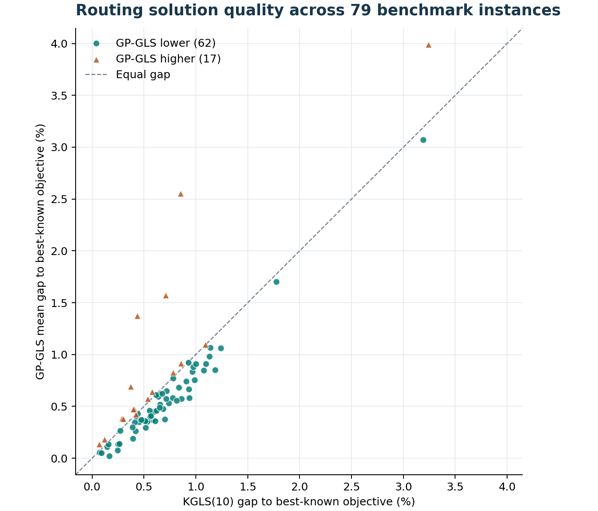

# GP-GLS · Genetic programming for vehicle routing

Guided local search chooses parts of a route to penalise so that it can explore different solutions. This research investigates whether genetic programming can learn utility functions for that choice. This repository contains the archived results and the Python analysis used to inspect them. [Research overview](https://itissn.github.io/research-projects.html)

## Objective and method

Compare route quality from the evolved guidance functions with the workbook’s KGLS(10) reference. For each benchmark instance, the analysis averages its 15 recorded GP-GLS objectives, computes both methods’ gaps to the same best-known objective and gives each instance equal weight.

## Results

| Recorded comparison | Recomputed value |
|---|---:|
| GP-GLS mean gap to best-known objective | 0.6510% |
| KGLS(10) mean gap | 0.6924% |
| Difference between the means | 0.0414 percentage points |
| Instances with a lower / equal / higher GP-GLS gap | 62 / 0 / 17 |

Lower gaps indicate shorter routes relative to the recorded best-known objective. Each point below represents one instance. Points below the diagonal favour GP-GLS.



The audit found ten discrepancies in the archived footer. The table and chart use all 79 instance rows. [Original workbook](results/Final%20Result.xlsx) · [Audit and formulas](results/README.md) · [Machine-readable results](results/derived/summary.json)

## Limits

The workbook gives 15 GP-GLS values per instance. Seeds, execution budgets and a runnable solver are unavailable in this archive. These results describe the recorded instances. A controlled comparison would require matching budgets, seed information and repeated solver runs.

## Reproduce

```bash
python -m pip install -r requirements.txt
python analysis/summarise_results.py
```

The [analysis script](analysis/summarise_results.py) reads the original workbook and writes the chart, instance table, discrepancies and source hash to [results/derived](results/derived/). Use `--output-dir PATH` to generate a second copy for comparison.

**Skills demonstrated**

- Genetic programming and guided local search for vehicle routing
- Python and openpyxl for schema checks, formula reconciliation and paired analysis
- Matplotlib for instance-level comparisons
