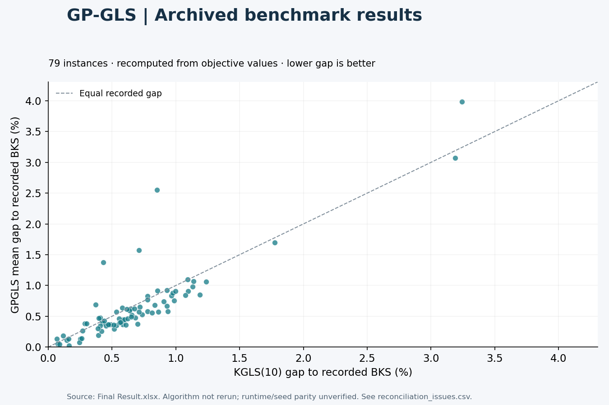

# GP-GLS — Genetic Programming for Search Guidance

Investigate whether automatically evolved utility functions can improve guided local search for large-scale vehicle routing.

## Research problem and objective

Guided local search needs a rule for choosing which features of a current solution to penalise. That rule is a search-design decision: its definition affects where the search goes next. The design question motivating this work is whether useful guidance can be evolved rather than supplied only as a fixed, manually designed rule.

The research objective is to **evolve utility functions with genetic programming and assess the resulting routing-solution quality against a reference guided-local-search method**. The [research overview](https://itissn.github.io/research-projects.html) describes the broader project. This repository preserves its results artifact and analysis; it does not contain the complete training or solver implementation.

## Method and the role of this repository

The research approach uses genetic programming to construct utility functions from instance-, solution- and edge-level features, which then guide local search.

The analysis included here examines the archived outcomes: read the workbook, recompute each objective's percentage gap to its recorded best-known value, aggregate consistently across instances, and plot the comparison. Keeping the original workbook separate from derived tables makes the numerical evidence inspectable without altering its source.

## Recorded results

The workbook contains **79 instances** and **15 recorded GP-GLS result columns**. Recalculation from instance rows gives:

| Recorded method | Mean gap to the workbook's best-known value |
|---|---:|
| GP-GLS, averaging its 15 recorded values per instance | 0.6510% |
| KGLS | 0.6924% |

Lower gap is better. GP-GLS has the lower mean in this archived table, with each instance weighted equally. This descriptive comparison does not establish statistical significance or general superiority under matched computational budgets.



Evidence: [original workbook](results/Final%20Result.xlsx), [analysis script](analysis/summarise_results.py), [derived summary](results/derived/summary.json) and [reconciliation notes](docs/results_notes.md). Ten footer summaries differ from full-row recalculation; the original file is preserved and the displayed results use the instance rows.

## Limits of the available evidence

The repository does not establish seeds, complete execution budgets or all experimental settings. The 15 result columns should not be assumed to be independent random-seed trials. Reproducing the solver and making stronger comparative claims would require the implementation, experiment configuration and controlled repeated runs. The added Python analysis reproduces the summaries, not the original optimisation experiments.

**Research and analysis:** Genetic programming · Guided local search · Vehicle routing · Python · Matplotlib

## Reproduce the analysis

```bash
python -m pip install -r requirements.txt
python analysis/summarise_results.py
```

This reads the original workbook, recomputes gaps and per-instance means, checks stored summaries and writes the figure and derived tables. It does not rerun GP-GLS.

## Repository guide

| Location | Responsibility |
|---|---|
| `results/Final Result.xlsx` | Original workbook, preserved without edits |
| `analysis/summarise_results.py` | Reproducible post-processing |
| `results/derived/` | Instance summary, reconciliation details and provenance hash |
| `assets/benchmark_results.png` | Figure generated from recorded values |
| `docs/results_notes.md` | Formula, scope and reconciliation notes |

The analysis identifies ten differences between stored footer values and a full-row recalculation. See [results notes](docs/results_notes.md) for the affected formulas and the distinction between source and derived results.
